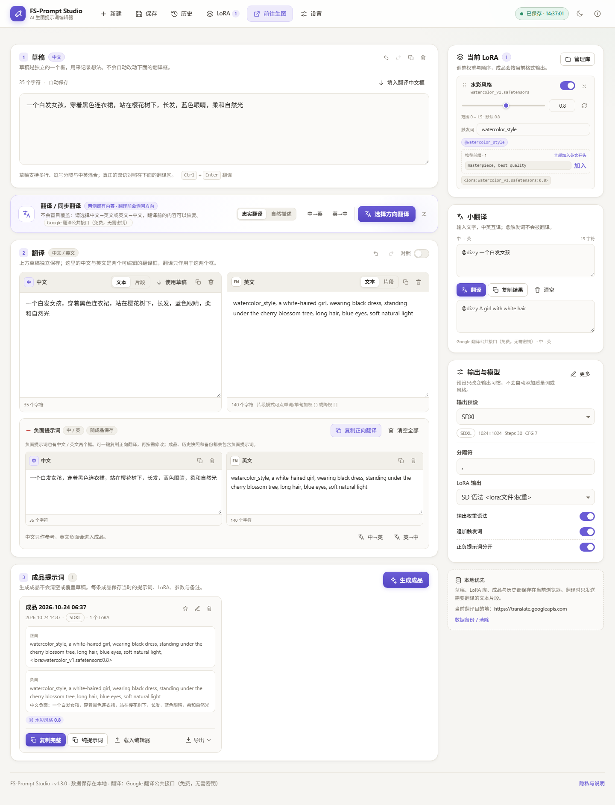
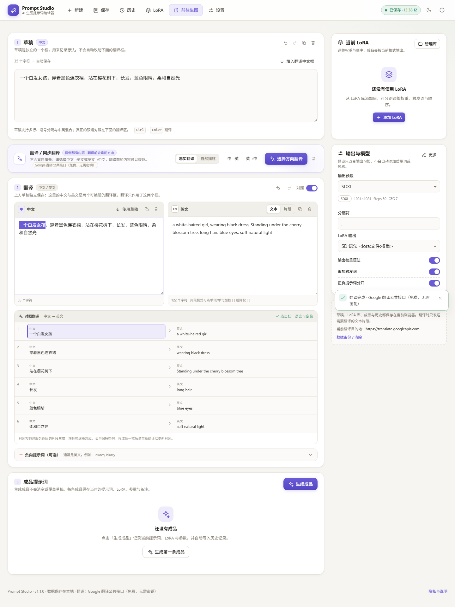
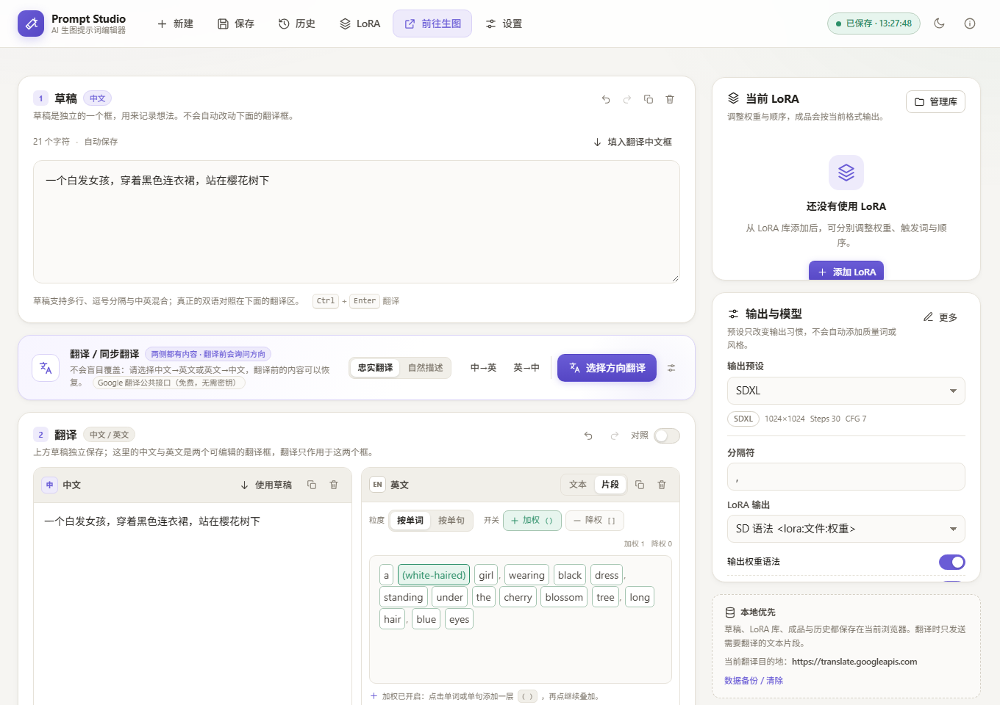
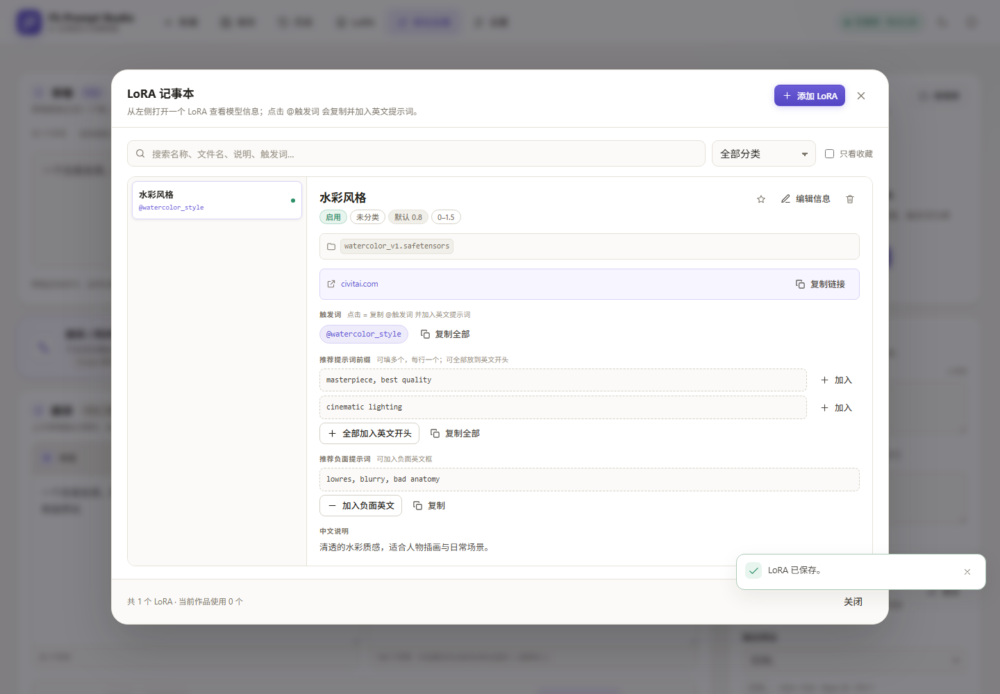
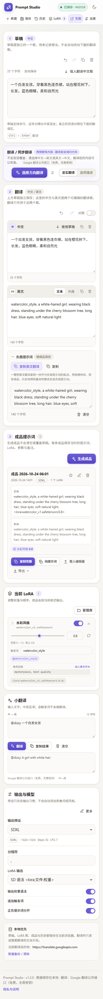
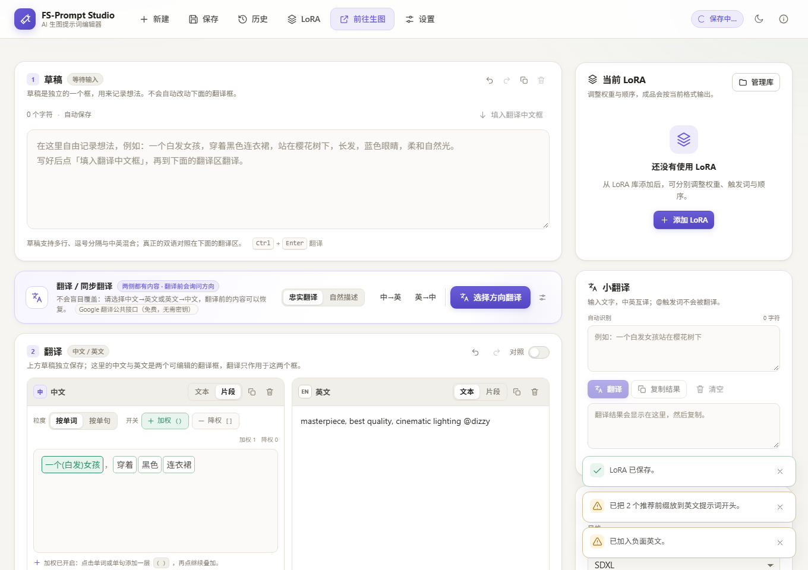
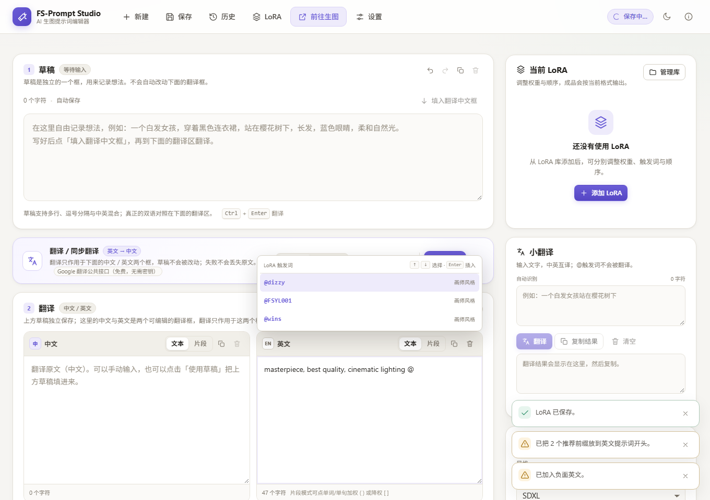
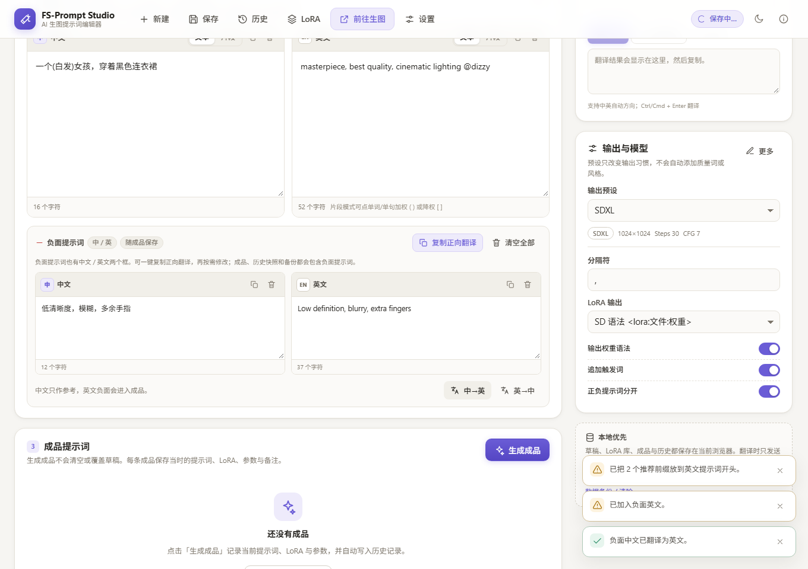
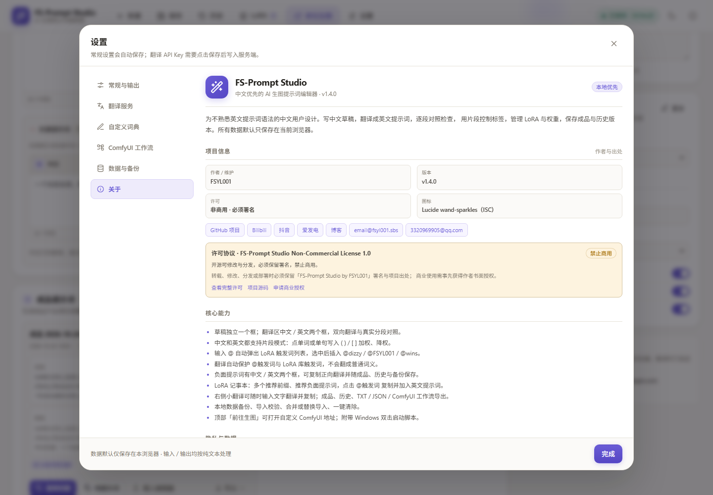

# FS-Prompt Studio · AI 生图提示词编辑器

面向中文用户的 AI 生图提示词工作台：草稿独立记录想法，翻译区用「中文 / 英文」两个框精确对照，中文和英文都支持片段模式点单词/单句加权降权；LoRA 用记事本管理多个推荐前缀、推荐负面和 `@触发词`，输入 `@` 自动补全触发词；成品与历史全部保存在本地。



| 中文 / 英文双框对照 | 点单词 / 单句加权 |
| --- | --- |
|  |  |

| LoRA 记事本 | 移动端 |
| --- | --- |
|  |  |

| 中文片段加权 | 输入 @ 自动补全触发词 |
| --- | --- |
|  |  |

| 负面提示词中英双框 |
| --- |
|  |

## 项目信息



- 作者 / 维护：**FSYL001**
- 版本：**v1.4.0**
- GitHub：<https://github.com/FSYL001/FS-Prompt-Studio>
- Bilibili：<https://space.bilibili.com/450000657>
- 抖音：<https://www.douyin.com/user/MS4wLjABAAAAzWfG071S0Ol0_wF3xT1i0oL5eSpPdiYZZY_gKib9S_M>
- 爱发电：<https://ifdian.net/a/fsyl001>
- 博客：<https://blog.fsyl001.sbs>
- 邮箱：<email@fsyl001.sbs> / <3320969905@qq.com>
- 图标：Lucide `wand-sparkles`（ISC），见 [THIRD_PARTY_NOTICES.md](THIRD_PARTY_NOTICES.md)


---

## 1. 界面结构

### 顶部工具栏

新建、保存、历史、LoRA、**前往生图**、设置、保存状态、主题切换。

- 「前往生图」默认打开 `http://127.0.0.1:8188/`（ComfyUI）。
- 地址可在「设置 → 常规与输出 → 生图工作台」中修改，支持任何 `http://` / `https://` 地址。
- 始终在新标签页打开，不会把生图页面嵌进本站。

### 草稿（独立一个框）

- 只用来记录想法，支持中文 / 英文 / 中英混合、多行、自动保存。
- 不会自动改动下面的翻译框。
- 「填入翻译中文框」把草稿复制到翻译区；也可以直接点主翻译按钮，首次翻译会自动填入。
- 支持撤销/重做、复制、清空。

### 翻译（中文 / 英文两个框）

- 左边中文框、右边英文框，两个框都可以直接编辑。
- 中→英、英→中双向翻译；两侧都有内容时弹窗询问方向，不会静默覆盖。
- 翻译前内容会保留，可恢复；失败不写入任何内容。
- 可开启「对照」查看真实分段对照：点击中文单元格定位中文框，点击英文单元格定位英文框。
- 长句保持整句对照，不按英文空格伪造逐词映射。

### 片段模式：点单词 / 单句加权

**中文框和英文框都支持片段模式。** 切到「片段」后，文字会以可点击的方框显示：

1. 选择粒度：**按单词** 或 **按单句**。
2. 打开「加权」或「降权」开关。
3. 点击任意单词或单句：
   - 加权：`word` → `(word)` → `((word))`
   - 降权：`word` → `[word]` → `[[word]]`
   - 用相反开关点击会取消一层。
4. 括号语法直接写回英文提示词，文字本身保持不变。

顶部会统计当前加权 / 降权片段数。

> 括号权重是常见 SD 语法，但不同模型前端支持程度不同；本工具不保证所有前端都识别。

### 翻译不翻译 LoRA 触发词

- 任何 `@dizzy`、`@watercolor_style` 形式的 @词元都会被服务端保护，翻译前后保持原样。
- LoRA 库和当前作品里的触发词（即使不带 `@`）也会作为保护词表发送，避免被当成普通英文翻译。
- 主翻译、右侧小翻译、负面提示词翻译、片段翻译都走同一层保护。

### LoRA 记事本

- 左侧是 LoRA 列表，右侧是打开的模型详情，类似记事本。
- 详情包含文件名、**原始链接（Civitai 等）**、触发词、**多个推荐提示词前缀**、**推荐负面提示词**、中英文说明、推荐权重、适用模型、备注。
- 原始链接保存后可在详情直接打开，也可复制，方便以后找回模型出处。
- 触发词显示为 `@dizzy`、`@FSYL001`、`@wins` 这样的标签。
- **点击触发词 = 复制 `@触发词` 到剪贴板 + 加入英文提示词**（已存在则不重复添加）。
- 推荐前缀每行一个，可单独「加入」或「全部加入英文开头」；当前 LoRA 面板也可以再次加入，不会自动改写译文。
- 推荐负面提示词可一键加入负面英文框。
- 支持「复制全部」、添加到当前作品、调整权重、拖动排序、收藏、启用/停用、编辑、删除。
- 文件名缺失时明确提示，并拒绝生成错误的 LoRA 语法。

### 输入 @ 自动补全触发词

在草稿、中文 / 英文翻译框、负面框或小翻译输入框中输入 `@`：

- 自动弹出 LoRA 库里的全部触发词，继续输入 `@di`、`@FS` 会过滤。
- `↑` / `↓` 选择，`Enter` / `Tab` 插入，`Esc` 关闭。
- 插入 `@dizzy`、`@FSYL001`、`@wins` 原词，不经过翻译。

### 负面提示词

- 负面提示词现在是**中文框 + 英文框**，和正向翻译一样可以双向翻译。
- 点「复制正向翻译」会把正向中文、英文各复制一份到负面两个框，再手动修改。
- 支持复制、单独清空、中→英 / 英→中翻译和「清空全部」。
- 负面英文会随成品、历史快照和完整备份一起保存；负面中文也会保存并在成品卡片中显示。

### 右侧小翻译

位于右栏「当前 LoRA」和「输出与模型」之间：

- 输入任意文字，自动判断中→英 / 英→中，点击翻译。
- 翻译结果可复制，不会自动改写草稿或翻译框。
- LoRA 触发词（`@dizzy` 等）和已知触发词会原样保留，不会被翻成「眩晕」这类普通词义。

### 成品与历史

- 生成成品不会清空草稿或翻译框。
- 成品保存当时的正向/负向、LoRA（含多个推荐前缀/推荐负面）、参数、中文草稿、中文翻译、英文、片段快照。
- 支持编辑、收藏、重命名、载入编辑器、删除、复制、导出 TXT/JSON。
- 历史自动记录成品生成、手动保存、新建/恢复前的自动备份。
- 支持搜索、排序、收藏筛选、查看、对比、恢复、批量删除、导出。
- 备份导出/导入、合并/替换、Schema 校验与预览。

---

## 2. 安装与启动

### 免安装便携版（Windows x64）

下载并解压：

`FS-Prompt-Studio-v1.4.0-Windows-x64-portable.zip`

1. 解压到任意目录（中文路径也可以）；
2. 双击 `start.bat`；
3. 浏览器自动打开 <http://127.0.0.1:8787>。

内置生产构建、`node_modules` 与 Node 运行时，**不需要 `npm install`**。关闭命令行窗口即停止服务；数据仍保存在浏览器 IndexedDB 中。

### 方式一：双击 `start.bat`（源码开发版）

双击根目录的 `start.bat`：

1. 检查 Node.js；
2. 首次运行自动 `npm install`；
3. 启动前端与 API；
4. 自动打开 <http://127.0.0.1:5173>；
5. 如果服务已经在运行，则只打开浏览器，不会重复启动。

保持命令行窗口开启；按 `Ctrl+C` 停止服务。

### 方式二：命令行

```bash
npm install
npm run dev
```

- 前端：<http://127.0.0.1:5173>
- API：<http://127.0.0.1:8787>

### 生产模式

```bash
npm run build
npm start
```

默认在 <http://127.0.0.1:8787> 同时提供页面与 API，可用 `PORT` / `HOST` 修改。

> 服务端没有账号鉴权，默认只监听 `127.0.0.1`，不要直接暴露公网。

环境要求：Node.js 20+（本机验证 Node 22.13 / Windows 11）；Chrome/Edge 已验证。

---

## 3. 翻译服务配置

### 默认：Google 翻译公共接口

无需 API Key，真实机器翻译。默认地址 `https://translate.googleapis.com`。

这是非官方公共接口，可能限流或不可用；请求失败会显示中文原因并保留原文。已内置 401/403/404/429/超时/网络错误处理与 24 小时服务端缓存。

### 推荐：OpenAI 兼容接口

「设置 → 翻译服务」选择「OpenAI 兼容接口」，填写接口地址、模型与 Key：

- OpenAI：`https://api.openai.com/v1`，例如 `gpt-4o-mini`
- DeepSeek：`https://api.deepseek.com/v1`，例如 `deepseek-chat`
- 自建兼容服务：只要支持 `/chat/completions`

保存后点「测试连接」实际翻译一条示例；支持把自定义词典作为术语表发送。

### DeepL

选择 DeepL，免费版地址 `https://api-free.deepl.com`，付费版 `https://api.deepl.com`。

### 模拟翻译（明确标注）

只做少量内置词典替换，未收录内容保留中文；界面标注「模拟翻译」，仅用于测试界面，不代表真实翻译。

### 密钥存储

- 服务端文件：`server/data/translate-config.json`（已 gitignore）
- 或环境变量：

| 变量 | 说明 |
| --- | --- |
| `PROMPT_STUDIO_TRANSLATE_PROVIDER` | `google-free` / `openai` / `deepl` / `mock` |
| `PROMPT_STUDIO_TRANSLATE_BASE_URL` | 接口地址 |
| `PROMPT_STUDIO_TRANSLATE_MODEL` | 模型名称 |
| `PROMPT_STUDIO_TRANSLATE_API_KEY` | 通用密钥 |
| `OPENAI_API_KEY` / `DEEPL_API_KEY` | 对应服务密钥 |
| `PROMPT_STUDIO_TRANSLATE_TIMEOUT_MS` | 超时毫秒数 |
| `PROMPT_STUDIO_DATA_DIR` | 服务端配置目录 |

浏览器接口永远不返回 Key 明文，只能看到「已配置 / 未配置 / 来自环境变量」。

---

## 4. 使用流程

1. **草稿**：写下中文想法。
2. **填入翻译**：点草稿的「填入翻译中文框」，或在翻译区直接输入中文。
3. **翻译**：点「翻译」生成英文；两侧都有内容时会询问方向。
4. **对照**：打开「对照」，点击中文/英文单元格定位。
5. **修英文**：直接编辑英文框。
6. **加权**：英文框切到「片段」，选择按词/按句，打开加权/降权，点击文字。
7. **LoRA**：打开 LoRA 记事本，查看模型信息，点击 `@触发词` 复制并加入英文，再调整权重；可把多个推荐前缀放到英文开头，也可把推荐负面加入负面英文。
8. **负面提示词**：点「复制正向翻译」复制中英两份再修改，成品会一起保存。
9. **小翻译**：右栏小翻译可随时输入文字翻译并复制，不影响当前提示词。
10. **生成成品**：选择预设与参数后生成；草稿、翻译和负面提示词都不变。
11. **导出 / 前往生图**：复制或导出提示词，点顶部「前往生图」打开 ComfyUI。

### 自动保存与历史行为

| 行为 | 触发 | 保存位置 |
| --- | --- | --- |
| 自动保存草稿/翻译/片段/LoRA | 编辑后约 400ms / 页面隐藏 | `workspace` |
| 生成成品 | 手动点击 | `products` + 一条历史快照 |
| 手动保存版本 | 历史面板 | `history` |
| 新建 / 恢复 / 载入成品前 | 操作前 | 自动历史备份 |

---

## 5. 技术架构

- React 18 + TypeScript + Vite + Zustand
- 原生 CSS 设计令牌（浅色/深色/响应式）
- IndexedDB 本地数据
- Node.js + Express 翻译代理与配置
- Zod 数据校验
- Vitest + Playwright

### 目录

```text
.
├─ start.bat                   Windows 双击启动
├─ server/
│  ├─ app.ts / config.ts / index.ts
│  └─ translate/{index,guard,http,types}.ts + providers/
├─ src/
│  ├─ domain/
│  │  ├─ types.ts              数据结构（Zod）
│  │  ├─ promptParse.ts        分词、拆段、双语重组、对齐
│  │  ├─ weights.ts            单词/单句加权降权与解析
│  │  ├─ product.ts            成品组装与导出
│  │  ├─ lora.ts / presets.ts
│  │  └─ workflow.ts           ComfyUI 节点改写
│  ├─ db/                      IndexedDB 与备份/导入
│  ├─ services/                翻译 API 客户端与编排
│  ├─ store/appStore.ts        全局状态与业务动作
│  ├─ components/
│  │  ├─ DraftPanel.tsx        草稿（一个框）
│  │  ├─ TranslationPanel.tsx  翻译（中文/英文两个框）
│  │  ├─ WeightedPromptEditor.tsx  片段加权
│  │  ├─ AlignedPairs.tsx      双语对照
│  │  ├─ LoraLibraryModal.tsx  LoRA 记事本
│  │  └─ 其它编辑器/历史/设置/成品组件
│  └─ styles/global.css + v11.css
├─ tests/                      77 项 Vitest
├─ scripts/                    E2E 与截图脚本
└─ docs/screenshots/
```

### 翻译流程

```text
中文翻译框
  → tokenizePrompt()：顶层逗号/分号/句末标点分段，括号内不断开
  → 只发送需翻译的 content 片段（英文片段跳过）
  → POST /api/translate
      → 保护 <lora:...> / BREAK / :权重数字
      → Provider 批量翻译
      → 占位符还原；丢失则整次取消，不写回
  → composeTranslatedText()：标点映射、重组、记录字符区间
  → 英文框 + Alignment.pairs
```

失败时目标框不变，错误以中文展示，可重试。

### ComfyUI

| 输出 | 说明 |
| --- | --- |
| ComfyUI 纯提示词 | 英文 + LoRA 触发词，不含 `<lora:...>` 文本 |
| ComfyUI 工作流 JSON | 基于用户 API 格式模板改写映射节点 |
| 纯提示词 JSON | 明确标注不可直接作为工作流运行 |

工作流导出只改写：正向/负向 CLIPTextEncode 的 `text`、按顺序映射的 `LoraLoader` 的 `lora_name` / `strength_model` / `strength_clip`、可选 `CheckpointLoader.ckpt_name`。

会移除文本中的 `<lora:...>` 并提示，因为 ComfyUI 通过 LoraLoader 节点应用 LoRA；界面格式 JSON、节点类型不匹配、数量不足或缺少文件名都会明确报错。

---

## 6. 数据结构

定义于 `src/domain/types.ts`，均使用 Zod 校验。IndexedDB：`prompt-studio`，版本 1。

| 实体 | 关键字段 |
| --- | --- |
| `Workspace` | `draftText`、`translationZhText`、`englishText`、`negativeText`、`negativeZhText`、`alignment`、`segments`、`activeLoras`、`params`、`presetId`、`notes` |
| `Lora` | `name`、`file`、**`sourceUrl`**、`triggerWords[]`、**`promptPrefixes[]`**（兼容旧 `promptPrefix`）、**`recommendedNegative`**、`descCn/En`、`defaultWeight`、`weightMin/Max`、`modelTypes[]`、`category`、`notes`、`favorite`、`enabled` |
| `ProductLora` | 作品内 LoRA 快照：`name`、`file`、`sourceUrl`、`weight`、`triggerWords[]`、`promptPrefixes[]`、`promptPrefix`、`recommendedNegative`、`enabled` |
| `Product` | `positive`、`negative`、`negativeZhText`、`final`、`draftText`、`translationZhText`、`englishText`、`loras`、`params`、`output`、`notes`、`favorite` |
| `HistoryEntry` | `type`（product/draft/manual）、`name`、`snapshot`、`productId`、`favorite`、`createdAt` |
| `Settings` | `theme`、`generationUrl`（默认 `http://127.0.0.1:8188/`）、`presetId`、`output`、`translateMode`、`translator`（非密钥镜像）、`dictionary[]`、`workflows[]`、`historyLimit` |
| `Backup` | `app`、`formatVersion=1`、`exportedAt`、`data{settings,loras,products,history,workspace}` |

旧版本数据没有 `translationZhText` 时，会用 `draftText` 回填中文翻译框，避免内容看起来丢失；没有 `negativeZhText` / `promptPrefixes` 时分别默认空字符串与空数组，旧 `promptPrefix` 仍可读取。

### 翻译 API

`POST /api/translate`：

```json
{
  "segments": [{ "id": "s1", "text": "一个白发女孩" }],
  "direction": "zh-en",
  "mode": "faithful",
  "dictionary": [{ "cn": "樱花", "en": "cherry blossoms" }],
  "protectedTerms": ["dizzy", "watercolor_style"]
}
```

其它接口：`GET /api/health`、`GET/PUT /api/translate/config`、`POST /api/translate/test`。错误统一为 `{ error: { code, message, hint } }`。

---

## 7. 本地数据、备份与隐私

- 草稿、翻译、LoRA、成品、历史、设置保存在当前浏览器 IndexedDB。
- 只有点击翻译时，需要翻译的片段才会经本地后端发送到所配置的翻译服务。
- API Key 只保存在服务端配置文件或环境变量。
- 导入备份：10MB 上限、Zod 校验、导入预览、合并/替换、文本按纯文本渲染、不执行脚本。
- 清除全部数据需要两次确认；服务端翻译配置不受影响。
- 建议定期导出备份；清理浏览器站点数据会导致本地内容丢失。

---

## 8. 测试与验收结果

```bash
npm test
```

结果：**9 个测试文件、77 项全部通过**。

覆盖：语言识别、分词/分段、括号与 LoRA 标签保护、标点映射、对齐区间、长句整句对照、片段权重括号、加权统计、成品组装、LoRA 语法、TXT 导出、翻译编排/缓存/跳过/失败、ComfyUI 节点改写、版本 diff、IndexedDB、备份导入、Express API（密钥不回传）。

浏览器端到端（需先安装 Chromium）：

```bash
npx playwright install chromium
npm run dev
npm run e2e:smoke     # 翻译 → 对照 → LoRA → 成品 → 刷新持久化 → 历史 → 设置 → 生图跳转 → 深色 → 移动端
npm run e2e:flows     # 中英片段加权 → 两个 LoRA/多前缀 → @ 补全 → 负面双框 → 成品编辑 → 历史对比/恢复 → ComfyUI → 备份导出/导入 → 删除
npm run e2e:failure   # 缺 Key 时草稿/中文翻译/英文均不被覆盖
```

实测：三组脚本全部通过；移动端无横向溢出。

### 验收标准

| # | 验收项 | 结果 |
| --- | --- | --- |
| 1 | 输入「一个白发女孩，穿着黑色连衣裙」能翻译成自然英文 | ✅ 实测 `A girl with white hair wearing a black dress`；长句结果见截图 |
| 2 | 可以修改英文 | ✅ 直接编辑，E2E 验证 |
| 3 | 修改中文后选择方向重新翻译 | ✅ 双框都有内容时弹出方向选择 |
| 4 | 中英对照正常 | ✅ 真实分段；点击中文/英文单元格分别定位 |
| 5 | 修改片段后成品同步 | ✅ 片段加权写回英文，成品包含括号 |
| 6 | 添加多个 LoRA | ✅ E2E 同时使用 2 个 |
| 7 | 分别调整权重 | ✅ 0.65 / 1.1，刷新后保留 |
| 8 | 保存、删除、恢复成品 | ✅ 生成、编辑、收藏、载入、删除；历史恢复 |
| 9 | 刷新后草稿和 LoRA 保留 | ✅ 草稿、翻译、LoRA、权重、成品均保留 |
| 10 | 历史正确恢复 | ✅ 对比后恢复旧草稿版本 |
| 11 | 导出和导入数据正常 | ✅ 备份导出、预览、合并导入成功 |
| 12 | 翻译失败不丢原文 | ✅ 草稿/中文翻译/已有英文均未改变 |
| 13 | 切换方向不无提示覆盖 | ✅ 方向弹窗 + 替换确认 + 恢复入口 |
| 14 | ComfyUI 不产生虚假兼容性 | ✅ 拒绝界面格式、校验节点、移除文本 LoRA 语法 |
| 15 | 手机端可用 | ✅ 390×844 无横向溢出；双框堆叠、工具栏换行 |
| 16 | 负面提示词中英双框并随成品保存 | ✅ 「复制正向翻译」同时填充负面中文/英文；成品卡片显示负向，历史与 TXT 也保存 |
| 17 | LoRA 多个推荐前缀 + 推荐负面 | ✅ 可填多行前缀、全部加入英文开头；推荐负面可加入负面英文；成品快照保留 |
| 18 | 右侧小翻译与 @触发词保护 | ✅ 输入 `@dizzy 一个白发女孩` 返回 `@dizzy A girl with white hair` |
| 19 | 中文也支持片段加权 | ✅ 中文按词切分，如「一个 / 白发 / 女孩」，点击后写入 `(白发)` |
| 20 | 输入 @ 自动补全触发词 | ✅ 弹出 LoRA 库 `@dizzy` / `@FSYL001` / `@wins`，支持过滤、键盘选择与插入 |
| 21 | 175% 缩放侧栏可点击 | ✅ 侧栏取消内部裁切，低高度下随页面滚动，快速翻译/LoRA/输出卡片均可到达 |
| 22 | LoRA 原始链接 | ✅ 可保存 Civitai 等 URL，详情显示可点击出处、复制链接，并进入成品快照 |
| 23 | 项目详情 / 开源许可 / 矢量图标 | ✅ 关于页含作者、社交链接、邮箱、许可摘要；Lucide 矢量图标与 ISC 署名 |

> 本机没有真实 OpenAI/DeepL 密钥，这两家只验证了配置保存、缺 Key 报错、密钥不回传等接口行为；翻译质量验证使用 Google 公共接口与模拟服务。

---

## 9. 已知限制

1. Google 公共接口非官方，可能限流或不可用。
2. OpenAI / DeepL 未做真实密钥联调。
3. 加权按钮只在文字外增加/移除一层 `()` / `[]`，不自动写数字权重；需要数值时可直接编辑英文文本。
4. 中文片段使用 `Intl.Segmenter` 做轻量分词，不是词典级精确分词；不同浏览器切出的词可能略有差异，可切「按单句」或直接编辑。
5. 对照粒度来自请求片段，不是词级语义对齐。
6. LoRA `@触发词` 是普通文本，不是所有前端的特殊语法；点击时复制到剪贴板，浏览器可能因权限拒绝复制，但加入提示词仍会执行。翻译会原样保留 `@触发词`；推荐前缀需要手动加入，不会自动改写译文。
7. 负面提示词的「复制正向翻译」是原样复制，不会自动追加 `lowres` 等通用负向词。
8. @ 自动补全只在文本框模式生效；片段模式下请先切回「文本」，或直接编辑后切片段。
9. ComfyUI 只支持 API 格式模板，节点 ID 需手动配置；模型文件名需与本地环境一致。
10. 没有账号与云同步；数据绑定单个浏览器。
11. 移动端 HTML5 拖拽可能失效，LoRA/片段排序提供按钮或列表选择。
12. 服务端无鉴权，默认只监听本机。
13. Firefox / Safari 未做 E2E 验证。
14. 成品编辑不会反向同步当前编辑器。

---

## 10. 后续可扩展

- 给片段加权增加数字权重（`(word:1.2)`）与撤销栈。
- 中文分词词典/自定义词组。
- 更多翻译商、术语表、离线模型。
- ComfyUI 节点自动探测与可视化映射。
- 账号与可选云同步、加密备份。
- 提示词模板库、风格库、图片预览。
- CI 自动化与更多浏览器测试。

---

## 11. 常见问题

### 双击 start.bat 没反应 / 提示 Node.js 不存在

安装 Node.js 20+ 后重启命令行。若端口 8787 已被占用，脚本只会打开浏览器，不会重复启动。

### 点「前往生图」打开 404 / 连接失败

ComfyUI 默认地址是 `http://127.0.0.1:8188/`。请先启动 ComfyUI，或在设置里改成你的 WebUI 地址。

### 翻译失败

检查 API Key、接口地址、模型名；或改用默认 Google 公共接口。失败不会修改任何输入。

### 两侧都有内容为什么弹窗

避免覆盖你手动改过的译文。选择方向后，被替换内容仍可恢复。

### 片段模式点字没反应

需要先打开「加权」或「降权」开关；再点文字会有绿色/黄色高亮反馈。

### 点击 @触发词没有复制

浏览器可能拒绝剪贴板权限（无痕模式/非安全上下文）；触发词仍会加入英文提示词，可手动复制。

### ComfyUI 导出失败

确认是「导出 (API)」格式、节点 ID 正确、LoRA 数量不超过 LoraLoader 节点数、LoRA 文件名已填写。

---

## 许可协议

本项目使用 **FS-Prompt Studio Non-Commercial License 1.0**：

- ✅ 允许个人学习、研究、修改、非商业分享与部署。
- ✅ **必须保留署名**：`FS-Prompt Studio by FSYL001` 以及项目出处链接。
- ❌ **禁止商用**：不得出售、付费分发、作为付费服务或商业产品的一部分使用。
- 商业授权请联系 <email@fsyl001.sbs> / <3320969905@qq.com>。

完整条款见 [LICENSE](LICENSE)；公开部署时请保留本协议与署名。

## 脚本速查

| 命令 / 文件 | 说明 |
| --- | --- |
| `start.bat` | 双击启动（自动安装依赖并打开浏览器） |
| `npm run dev` | 同时启动前端与 API |
| `npm run build` | 类型检查 + 构建前端 + 编译服务端 |
| `npm start` | 生产模式（默认 8787） |
| `npm test` | 77 项 Vitest |
| `npm run e2e:smoke` | 主流程浏览器验收 |
| `npm run e2e:flows` | 扩展流程验收 |
| `npm run e2e:failure` | 翻译失败保护验收 |
| `npm run docs:screenshots` | 重新生成文档截图（需服务运行） |
| `npm run typecheck` | 前后端类型检查 |

© 2026 FSYL001 · FS-Prompt Studio · 非商用需署名。图标来自 Lucide（ISC）。
