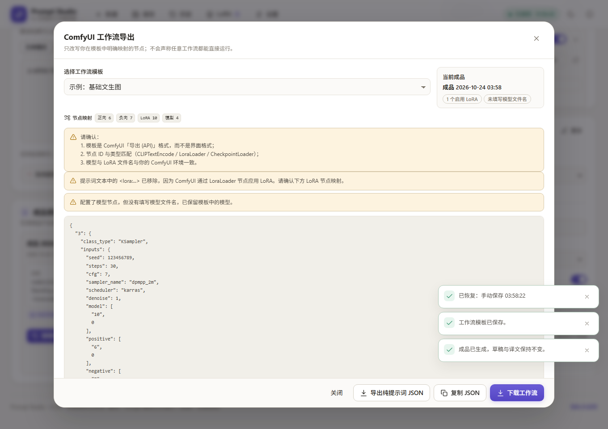

# Prompt Studio · AI 生图提示词编辑器

一个面向中文用户的 AI 生图提示词工作台：用中文写草稿，翻译成英文提示词，逐段对照检查，用片段与 LoRA 精细控制，保存成品和历史版本。

- **中文优先**：草稿、翻译方向、对照、错误提示全部使用中文。
- **本地优先**：草稿、LoRA、成品、历史默认只保存在当前浏览器。
- **真实可运行**：真实翻译服务、IndexedDB 持久化、撤销/重做、历史恢复、备份导入导出均已实现。
- **不伪造**：模拟翻译明确标注；长句不强行拆词对照；ComfyUI 不把 SD 的 `<lora:...>` 文本当成通用调用语法。


| 对照翻译 | ComfyUI 工作流导出 |
| --- | --- |
|  |  |


---

## 目录

1. [功能概览](#1-功能概览)
2. [安装与启动](#2-安装与启动)
3. [翻译服务配置](#3-翻译服务配置)
4. [使用流程](#4-使用流程)
5. [技术架构](#5-技术架构)
6. [数据结构](#6-数据结构)
7. [本地数据、备份与隐私](#7-本地数据备份与隐私)
8. [测试与验收结果](#8-测试与验收结果)
9. [已完成功能清单](#9-已完成功能清单)
10. [已知限制](#10-已知限制)
11. [后续扩展方向](#11-后续扩展方向)
12. [常见问题](#12-常见问题)

---

## 1. 功能概览

### 编辑器

- 中文 / 英文 / 中英混合草稿，自动识别语言，支持多行与自定义分段。
- 中文 → 英文、英文 → 中文两种方向；两侧都有内容时**必须选择方向**，不会静默覆盖。
- 翻译前保存原文与对照，可一键恢复翻译前内容，也支持撤销/重做。
- 翻译失败时原内容保持不动，显示中文错误原因与重试入口。
- 翻译结果可直接编辑；切换「文本模式 / 片段模式」互不破坏原文。
- 权重语法、LoRA 标签、`BREAK` 在翻译过程中受到保护，翻译服务破坏语法时整次翻译取消。

### 双语对照

- 基于真实翻译片段生成中英对应关系，而不是按英文空格拆词猜测。
- 短标签逐段对照；长句保持整句对照，并标记「整句」。
- 点击对照行会在对应文本框中选中真实字符区间；内容修改后会提示「对照可能过期」。
- 对照只影响显示，不会改写原始提示词。

### 片段管理

- 从英文提示词拆分片段，支持手动添加、拖动排序、上移/下移、复制、删除。
- 每个片段可单独修改、单独翻译、设置权重、标记正向/负向、锁定。
- 片段改动实时重新组合英文提示词；也支持手动「重新组合」。
- 完整句子可以作为一个片段保留，不会强制拆成标签。
- 自定义输出分隔符、每行输出、权重开关。

### 成品

- 一键生成成品，**不会清空或覆盖当前草稿**。
- 每条成品保存：名称、时间、正向/负向提示词、LoRA 与权重、模型与采样参数、备注、中文草稿、片段、输出设置。
- 支持收藏、重命名/编辑、重新载入编辑器、删除、复制完整提示词、复制纯提示词。
- 导出 TXT / JSON；可导出纯提示词 JSON，也可通过工作流模板导出真正可导入的 ComfyUI API 工作流。

### 历史记录

- 生成成品时自动写入完整历史快照。
- 新建、恢复历史、载入成品前自动备份当前编辑器，避免误覆盖。
- 搜索（名称/草稿/译文/备注）、按时间或名称排序、只看收藏、批量选择。
- 查看详情、恢复旧版本、比较两个版本（文本差异 + 参数/LoRA 差异）、删除单条/批量、清空。
- 导出全部 / 筛选结果 / 选中历史为 JSON。

### LoRA 管理

- 独立 LoRA 库：名称、文件名、触发词、中英文说明、默认权重、推荐范围、适用模型、分类、备注、收藏、启用状态。
- 搜索、分类筛选、收藏筛选、编辑、删除、启用/停用。
- 一键添加到当前作品、一键移除、多个 LoRA 同时使用、拖动调整顺序。
- 每个 LoRA 独立权重（数字输入 + 滑动条 + 默认值恢复），触发词可按作品覆盖。
- 输出格式：SD / WebUI 的 `<lora:文件名:权重>`、ComfyUI 纯提示词（只输出触发词）、自定义模板。
- 缺少文件名时明确警告，并拒绝生成错误的 LoRA 语法。

### 输出预设

- SD 1.5、SDXL、FLUX、ComfyUI 通用、自定义。
- 可配置分隔符、输出格式、是否输出权重、是否追加触发词、是否正负分离、是否附参数、是否使用自定义完整模板。
- 预设只改变默认输出习惯，**不会自动添加「masterpiece」「best quality」等原文没有的词**。

### 数据与设置

- 浅色 / 深色 / 跟随系统主题。
- 自动保存草稿；页面隐藏/刷新前再次尝试落盘。
- 完整备份导出、导入前 Schema 校验与预览、合并导入 / 替换导入。
- 清除全部本地数据（两次确认）。
- 翻译 API 配置保存在服务端，浏览器只能看到「是否已配置」。
- 自定义词典 / 固定译法、ComfyUI 工作流模板管理。

---

## 2. 安装与启动

### 环境要求

- Node.js **20 或以上**（已在 Node 22.13 / Windows 11 上验证）。
- npm 10+。
- 现代浏览器（Chrome / Edge 已验证；其它 Chromium 内核浏览器可用）。

### 开发模式

```bash
npm install
npm run dev
```

启动后：

- 前端：<http://127.0.0.1:5173>
- 后端 API：<http://127.0.0.1:8787>（Vite 会代理 `/api`）

`npm run dev` 会同时启动 Vite 与 Express，退出时一并清理。

### 生产模式

```bash
npm run build
npm start
```

- `npm run build` 会先做前后端 TypeScript 检查，再构建前端到 `dist/`，编译服务端到 `dist-server/`。
- `npm start` 由 Express 同时提供静态页面与 API，默认地址 <http://127.0.0.1:8787>。
- 可用环境变量调整：

```bash
PORT=9000 HOST=0.0.0.0 npm start
```

> 服务端默认只监听 `127.0.0.1`，且没有账号鉴权。请勿把 8787 端口直接暴露到公网。

如果页面打开失败：

- 先确认 5173（开发）或 8787（生产）端口可用；
- 打开 <http://127.0.0.1:8787/api/health> 检查后端；
- 查看终端中的服务端日志。

---

## 3. 翻译服务配置

### 默认服务：Google 翻译公共接口

开箱即用，不需要 API Key，是真实的机器翻译（不是模拟）。默认调用 `https://translate.googleapis.com`。

> 这是非官方公共接口，可能限流、被地区限制或随时不可用，适合个人试用与验证。正式长期使用建议配置自己的 OpenAI 兼容 API 或 DeepL。

已内置的处理：

- 429（限流）、401/403（密钥）、404（地址错误）、超时、网络错误均转换为中文提示；
- 服务端 24 小时内存缓存（相同配置 + 相同文本可直接复用）；
- 批量与长文本分段翻译，保持片段顺序；
- 语法保护失败时整次翻译取消，原内容不变。

### 推荐：OpenAI 兼容接口

在「设置 → 翻译服务」中选择「OpenAI 兼容接口」，填写：

| 字段 | 说明 |
| --- | --- |
| 接口地址 | 例如 `https://api.openai.com/v1`、`https://api.deepseek.com/v1`；也支持兼容 `/chat/completions` 的自建服务 |
| 模型名称 | 例如 `gpt-4o-mini`、`deepseek-chat` |
| API Key | 仅提交给本地后端保存，不写入浏览器存储 |
| 超时时间 | 默认 20 秒，可调 2–120 秒 |

保存后点击「测试连接」，会实际翻译一条示例并显示延迟与结果。支持将自定义词典作为术语表传给模型。

### DeepL

选择「DeepL API」，填入密钥：

- 免费版地址：`https://api-free.deepl.com`
- 付费版地址：`https://api.deepl.com`

DeepL 当前不应用自定义词典，也不使用「忠实 / 自然」模式差异（由 DeepL 自身决定风格）。

### 模拟翻译（仅演示）

选择「本地模拟翻译」后：

- 所有界面会明确显示「模拟翻译」；
- 结果来自少量内置词典替换，未收录内容保留中文；
- **不能把模拟结果当成真实翻译使用**。

### 密钥存储

- 服务端配置文件：`server/data/translate-config.json`（已被 `.gitignore` 忽略）。
- 或使用环境变量（优先级：配置文件中的密钥 > 环境变量）。
- 浏览器接口永远不会返回 Key 明文；设置页只显示「已配置 / 未配置 / 来自环境变量」。
- 修改配置后无需重启服务。

环境变量一览：

| 变量 | 说明 |
| --- | --- |
| `PROMPT_STUDIO_TRANSLATE_PROVIDER` | `google-free` / `openai` / `deepl` / `mock` |
| `PROMPT_STUDIO_TRANSLATE_BASE_URL` | 接口地址 |
| `PROMPT_STUDIO_TRANSLATE_MODEL` | 模型名称 |
| `PROMPT_STUDIO_TRANSLATE_API_KEY` | 通用密钥 |
| `OPENAI_API_KEY` | OpenAI 兼容接口密钥（未设置通用密钥时使用） |
| `DEEPL_API_KEY` | DeepL 密钥 |
| `PROMPT_STUDIO_TRANSLATE_TIMEOUT_MS` | 超时毫秒数 |
| `PROMPT_STUDIO_DATA_DIR` | 服务端配置目录（默认 `server/data`） |

PowerShell 示例：

```powershell
$env:PROMPT_STUDIO_TRANSLATE_PROVIDER = "openai"
$env:PROMPT_STUDIO_TRANSLATE_BASE_URL = "https://api.deepseek.com/v1"
$env:PROMPT_STUDIO_TRANSLATE_MODEL = "deepseek-chat"
$env:PROMPT_STUDIO_TRANSLATE_API_KEY = "sk-..."
npm run dev
```

### 自定义词典

「设置 → 自定义词典」可添加中文词 / 短语与固定英文译法。词典会随翻译请求发送给支持的翻译服务（当前为 OpenAI 兼容接口），并作为术语表注入提示词；Google 公共接口与 DeepL 当前不会应用术语表，界面中已明确提示。

---

## 4. 使用流程

1. **写草稿**：在「草稿」中输入中文，例如：`一个白发女孩，穿着黑色连衣裙，站在樱花树下`。
2. **翻译**：点击「翻译」。若英文框已有内容，会弹出方向选择或替换确认；被替换内容可用「恢复翻译前」找回。
3. **检查对照**：打开「对照翻译」，点击任一片段可定位到原文/译文的对应字符区间。长句会显示为整句对照。
4. **直接修改**：英文、中文都可以直接编辑；再次翻译前会确认方向，不会静默覆盖。
5. **整理片段**：切到「片段模式」，拖动排序、改权重、标记负向、锁定不想被批量翻译的片段。
6. **选择 LoRA**：从 LoRA 库添加，调整每个 LoRA 的权重与触发词；支持拖动排序。
7. **生成成品**：填写负向提示词（可选）→ 选择输出预设 → 点击「生成成品」。草稿保持不变。
8. **复用与导出**：复制完整提示词、载入编辑器、收藏、导出 TXT/JSON、或导出 ComfyUI 工作流。
9. **历史与备份**：在「历史」中查看/对比/恢复版本；在「设置 → 数据与备份」导出完整备份。

### 自动保存与历史不是同一件事

| 行为 | 触发 | 保存内容 | 位置 |
| --- | --- | --- | --- |
| 草稿自动保存 | 编辑后约 400ms / 页面隐藏 | 当前工作区（草稿、译文、负向、片段、LoRA、参数、备注） | `workspace` |
| 生成成品 | 手动点击「生成成品」 | 成品 + 一条完整历史快照 | `products` + `history` |
| 手动保存版本 | 历史面板「保存当前版本」 | 一条历史快照 | `history` |
| 新建 / 恢复 / 载入成品 | 执行操作前 | 当前内容自动备份为历史 | `history` |

因此：刷新页面不会丢草稿；生成成品不会清空草稿；恢复历史前也会先备份当前内容。

---

## 5. 技术架构

- **前端**：React 18 + TypeScript + Vite + Zustand。
- **样式**：原生 CSS 设计令牌，无重型 UI 框架；浅色/深色/响应式。
- **本地数据**：IndexedDB（手写轻量封装，带版本与迁移入口）。
- **后端**：Node.js + Express，仅负责翻译代理、配置保存与静态资源。
- **校验**：Zod Schema（本地数据、导入备份、API 请求）。
- **测试**：Vitest（单元/集成）+ Playwright（真实浏览器端到端）。

### 目录结构

```text
.
├─ server/
│  ├─ app.ts                   Express 路由、静态服务、错误处理
│  ├─ config.ts                翻译配置读取/保存（密钥不返回前端）
│  ├─ index.ts                 启动入口
│  └─ translate/
│     ├─ index.ts              翻译编排、缓存、批量、测试连接
│     ├─ guard.ts              权重 / LoRA / BREAK 语法保护
│     ├─ http.ts               fetch 超时与错误映射
│     ├─ types.ts              提供商接口与错误类型
│     └─ providers/
│        ├─ google.ts          Google 公共接口（node:https）
│        ├─ openai.ts          OpenAI 兼容 /chat/completions
│        ├─ deepl.ts           DeepL /v2/translate
│        └─ mock.ts            明确标注的本地模拟
├─ src/
│  ├─ domain/
│  │  ├─ types.ts              Zod Schema + TypeScript 类型
│  │  ├─ promptParse.ts        分词、拆段、双语重组、对照区间
│  │  ├─ product.ts            成品组装、TXT/JSON 导出
│  │  ├─ lora.ts               LoRA 语法与权重
│  │  ├─ presets.ts            模型预设
│  │  ├─ workflow.ts           ComfyUI 工作流节点改写
│  │  ├─ diff.ts               历史版本按行对比
│  │  └─ id.ts                 ID、时间、复制、下载
│  ├─ db/
│  │  ├─ database.ts           IndexedDB 封装
│  │  └─ repositories.ts       数据读写、备份、校验、导入
│  ├─ services/
│  │  ├─ translateApi.ts       前端 API 客户端
│  │  └─ translation.ts        分词 → 翻译 → 重组 → 对照
│  ├─ store/appStore.ts        全局状态与所有业务动作
│  ├─ hooks/useAppEffects.ts   自动保存、主题、快捷键
│  ├─ components/              编辑器、成品、历史、LoRA、设置、UI 原语
│  └─ styles/global.css        完整设计系统与响应式
├─ tests/                      Vitest 测试（65 项）
├─ scripts/                    开发启动、E2E、文档截图
└─ docs/screenshots/           README 截图
```

### 翻译数据流

```text
中文草稿
  → tokenizePrompt()：按顶层逗号/分号/句末标点切片，括号与标签不断开
  → 只发送需要翻译的 content 片段（英文片段直接跳过）
  → POST /api/translate
      → protectPromptSyntax()：<lora:...>、BREAK、:权重数字 → 占位符
      → 选中的 Provider 批量翻译
      → restorePromptSyntax()：占位符还原；丢失则整次取消（不写回）
  → composeTranslatedText()：按标点映射重组，记录 source/target 字符区间
  → 生成 Alignment.pairs（真实分段对照）
  → 显示英文 / 对照；原文保持不变
```

失败时：不修改目标字段，只记录错误并保留「恢复翻译前」入口。

### ComfyUI 的两套概念

| 输出 | 内容 | 用途 |
| --- | --- | --- |
| ComfyUI 纯提示词 | 英文提示词 + LoRA 触发词，**没有** `<lora:...>` | 粘贴到已有的 CLIPTextEncode 文本节点 |
| ComfyUI 工作流 JSON | 基于用户提供的 API 格式模板，改写映射节点 | 在 ComfyUI 中直接导入运行 |

工作流导出只改写：

- 正向 `CLIPTextEncode.inputs.text`
- 负向 `CLIPTextEncode.inputs.text`
- 按顺序映射的 `LoraLoader` 节点：`lora_name`、`strength_model`、`strength_clip`
- 可选的 `CheckpointLoader`：`ckpt_name`

同时：

- 文本中的 `<lora:...>` 会被移除并提示，因为 ComfyUI 通过 LoraLoader 节点应用 LoRA；
- 界面格式（含 `nodes` 数组）会明确拒绝，提示导出 API 格式；
- 节点类型不匹配、LoRA 数量超过映射节点、缺少文件名都会报错；
- 模板中未映射的节点保持不变，不会假装兼容整个工作流。

---

## 6. 数据结构

所有结构定义在 `src/domain/types.ts`，使用 Zod 进行运行时校验。

### IndexedDB

- 数据库：`prompt-studio`，版本 `1`
- 对象仓库：`workspace`、`loras`、`products`、`history`、`settings`、`meta`
- 备份格式版本：`1`（`formatVersion`）

### 核心实体

| 实体 | 关键字段 |
| --- | --- |
| `Workspace` | `draftText`、`englishText`、`negativeText`、`alignment`、`segments`、`segmentsMode`、`activeLoras`、`params`、`presetId`、`notes`、`updatedAt` |
| `Lora` | `id`、`name`、`file`、`triggerWords[]`、`descCn`、`descEn`、`defaultWeight`、`weightMin/Max`、`modelTypes[]`、`category`、`notes`、`favorite`、`enabled` |
| `ProductLora` | `loraId`、`name`、`file`、`weight`、`triggerWords[]`、`enabled`（作品内快照，库删除后仍保留） |
| `PromptSegment` | `id`、`text`、`translated`、`polarity`（正/负）、`locked`、`weight` |
| `Alignment` | `direction`、`sourceLang`、`targetLang`、`sourceText`、`targetText`、`pairs[]`、`provider`、`mock` |
| `AlignmentPair` | `source/target`、四组字符区间、`granularity`（segment/sentence）、`unchanged`/`uncertain` |
| `Product` | 快照字段 + `positive`、`negative`、`final`、`params`、`output`、`favorite`、`createdAt/updatedAt` |
| `HistoryEntry` | `type`（product/draft/manual）、`name`、`snapshot`、`productId`、`favorite`、`createdAt` |
| `Settings` | `theme`、`presetId`、`output`、`translateMode`、`translator`（非密钥镜像）、`dictionary[]`、`workflows[]`、`onboardingSeen`、`historyLimit` |
| `Backup` | `app`、`formatVersion`、`exportedAt`、`data{settings,loras,products,history,workspace}` |

### 翻译 API 契约

`POST /api/translate`

```json
{
  "segments": [
    { "id": "s1", "text": "一个白发女孩" },
    { "id": "s2", "text": "long hair" }
  ],
  "direction": "zh-en",
  "mode": "faithful",
  "dictionary": [{ "cn": "樱花", "en": "cherry blossoms" }]
}
```

响应：

```json
{
  "provider": "google-free",
  "providerLabel": "Google 翻译公共接口（免费，无需密钥）",
  "model": "gpt-4o-mini",
  "mock": false,
  "direction": "zh-en",
  "mode": "faithful",
  "results": [
    { "id": "s1", "text": "A girl with white hair", "cached": false, "skipped": false },
    { "id": "s2", "text": "long hair", "cached": false, "skipped": true }
  ]
}
```

其它接口：

- `GET /api/health` — 服务与翻译状态
- `GET /api/translate/config` — 公开配置（无密钥）
- `PUT /api/translate/config` — 保存服务类型、地址、模型、超时、密钥
- `POST /api/translate/test` — 连接测试（可传入未保存的表单值）

错误统一为：

```json
{ "error": { "code": "NO_KEY", "message": "尚未配置……", "hint": "……" } }
```

---

## 7. 本地数据、备份与隐私

- 草稿、LoRA 库、成品、历史、设置全部保存在浏览器 IndexedDB，默认不上传。
- 翻译时只发送**需要翻译的文本片段**与自定义词典，不发送草稿全文之外的数据。
- 设置页与关于页会显示当前翻译数据目的地（例如 `https://translate.googleapis.com`）。
- API Key 只保存在服务端配置或环境变量，前端只能看到「已配置」。
- 没有账号系统、没有云同步、没有遥测。
- 导入备份：

  - 文件大小上限 10MB；
  - Zod 严格校验实体结构；
  - 导入前显示数量、导出时间、是否包含草稿；
  - 支持合并（同 ID 保留更新时间较新的）或替换（二次确认）；
  - 所有文本按纯文本渲染，不使用 `dangerouslySetInnerHTML`，不执行导入内容中的脚本。

- 清除数据：设置 → 数据与备份 → 清除全部本地数据（两次确认）。服务端翻译配置不会被删除。
- 建议定期导出备份。清除浏览器站点数据会丢失全部本地内容。

---

## 8. 测试与验收结果

### 自动化测试

```bash
npm test
```

结果（本机实测）：**8 个测试文件，65 项全部通过**。

覆盖：

- 语言识别、分词/分段、括号与 LoRA 标签保护、标点映射、对照区间；
- 长句整句对照、权重/正负向、片段组合；
- 成品组装、无质量词注入、LoRA 语法、TXT 导出；
- 翻译编排（模拟服务）、缓存、跳过、顺序、密钥缺失、语法丢失取消；
- 语法占位符保护与还原；
- ComfyUI 工作流节点改写、UI 格式拒绝、节点/数量/文件名错误；
- 版本 diff；
- IndexedDB 持久化、备份校验、替换/合并导入、清空；
- Express API（健康检查、翻译、配置不回传密钥、错误码、404）。

### 浏览器端到端（Playwright）

先安装 Chromium：

```bash
npx playwright install chromium
```

保持 `npm run dev` 运行，然后：

```bash
npm run e2e:smoke       # 翻译 → 对照 → LoRA → 成品 → 刷新持久化 → 历史 → 设置 → 深色 → 移动端
npm run e2e:flows       # 片段编辑 → 两个 LoRA → 成品编辑/收藏 → 历史对比/恢复 → ComfyUI → 备份导出/导入 → 删除
npm run e2e:failure     # 翻译失败不丢原文、不覆盖已有译文
```

实测结果：三个脚本全部通过；移动端 390px 无横向溢出；桌面工具栏与移动端文字标签均可用。

### 验收标准逐项结果

| # | 验收项 | 结果 | 实测方式 |
| --- | --- | --- | --- |
| 1 | 输入「一个白发女孩，穿着黑色连衣裙」能翻译成自然英文 | ✅ | API 实测返回 `A girl with white hair wearing a black dress`；浏览器长句返回 `a white-haired girl, wearing black dress, ...` |
| 2 | 可以修改英文结果 | ✅ | E2E 中直接编辑英文并重新翻译 |
| 3 | 修改中文后可选方向重新翻译 | ✅ | 两侧都有内容时出现方向弹窗；选择中文 → 英文后重新生成 |
| 4 | 中英文对照正常工作 | ✅ | 真实分段对照截图；点击片段选中对应文本 |
| 5 | 修改片段后成品同步更新 | ✅ | 片段模式修改第一段后切回文本，英文同步；随后生成成品 |
| 6 | 能添加多个 LoRA | ✅ | E2E 同时添加 2 个 LoRA，成品显示 2 个 chip |
| 7 | 可分别调整每个 LoRA 权重 | ✅ | 分别设为 0.65 / 1.1，刷新后保持 |
| 8 | 保存、删除、恢复成品 | ✅ | 生成、编辑、收藏、载入编辑器、删除；历史快照可恢复 |
| 9 | 刷新后草稿和 LoRA 库仍存在 | ✅ | 刷新后草稿、LoRA、权重、成品均保留 |
| 10 | 历史记录能正确恢复 | ✅ | 保存两个版本 → 对比 → 恢复旧版本，草稿还原 |
| 11 | 导出和导入数据正常 | ✅ | 导出完整备份 → 导入预览 → 合并导入成功；单元测试覆盖替换/合并 |
| 12 | 翻译失败不丢原文 | ✅ | 缺 Key 时错误提示；草稿与已有英文均未改变 |
| 13 | 不因切换方向无提示覆盖编辑 | ✅ | 方向弹窗 + 替换确认 + 翻译前备份 |
| 14 | ComfyUI 不产生虚假兼容性 | ✅ | 单元测试 + 界面导出；拒绝界面格式、节点错误；移除文本 LoRA 语法 |
| 15 | 手机端布局可用 | ✅ | 390×844 E2E；无横向溢出；工具栏保留文字标签 |

> 说明：本机没有真实的 OpenAI/DeepL 密钥，因此这两家适配器只验证了「缺 Key 报错」「配置保存」「不回传密钥」等接口行为；实际翻译质量验证使用默认 Google 公共接口与模拟服务。接入真实密钥后可在设置页直接测试连接。

---

## 9. 已完成功能清单

- [x] 顶部工具栏：新建、保存、历史、LoRA、设置、状态、主题
- [x] 草稿：中文/英文/混合、自动保存、语言识别、撤销重做、复制、清空、多行
- [x] 翻译：双向、智能方向、冲突确认、失败保护、重试、超时、缓存、批量、长文本分段
- [x] 翻译前备份与恢复、恢复上次翻译结果
- [x] 语法保护：权重、括号、`<lora:...>`、`BREAK`
- [x] 双语对照：真实分段、整句标记、点击定位、过期提示、不破坏原文
- [x] 片段：编辑、拖动、上移下移、复制、删除、权重、正负向、锁定、单独翻译、批量翻译、重组
- [x] 负向提示词：单独输入、中文翻译按钮、与负向片段合并
- [x] 成品：生成、卡片列表、收藏、编辑、重命名、载入、删除、复制、TXT/JSON 导出
- [x] 历史：自动生成、搜索、排序、收藏筛选、详情、恢复、对比、批量删除、清空、导出
- [x] LoRA：完整 CRUD、搜索、分类、收藏、启用、触发词、默认/自定义权重、排序、多 LoRA
- [x] LoRA 输出：SD 语法、ComfyUI 纯文本、自定义模板
- [x] 模型预设：SD1.5 / SDXL / FLUX / ComfyUI / 自定义
- [x] 输出配置：分隔符、每行、权重、触发词、正负分离、参数、中文注释、自定义模板
- [x] ComfyUI：API 格式模板、节点映射、示例模板、校验、导出、错误提示
- [x] 数据：IndexedDB、版本、自动保存、备份导出、导入预览/校验/合并/替换、清空
- [x] 设置：主题、翻译服务、连接测试、词典、工作流、数据、关于
- [x] UI/UX：中文文案、新手引导、折叠负向、Toast、确认弹窗、错误中文、深色、响应式
- [x] 测试：65 项 Vitest + 3 组 Playwright 流程

---

## 10. 已知限制

1. **Google 公共接口非官方**：可能 429/超时/不可用；已内置中文错误提示与重试，但无法保证长期稳定。
2. **OpenAI / DeepL 未做真实密钥联调**：适配器已实现，接口行为已测试；翻译质量需用户用自己的密钥验证。
3. **对照粒度**：对齐来自「请求片段」的真实返回，不是词级语义对齐。短标签可逐段对应，长句按整句展示，不伪造逐词映射；翻译服务调整语序时，字符区间仍以片段为单位。
4. **自定义词典**：目前只注入 OpenAI 兼容接口；Google 公共接口与 DeepL 不应用术语表。
5. **ComfyUI 导出**：只支持 API 格式；必须手动配置节点 ID；模型/LoRA 文件名必须与本地环境一致；示例模板中的文件名需要替换。未在真实 ComfyUI 中自动安装或校验节点。
6. **模型语法差异**：FLUX、SDXL、SD1.5 对权重括号、LoRA 文本的支持取决于具体前端，预设只提供默认值。
7. **无账号/云同步**：数据绑定单个浏览器，清理站点数据会丢失；需手动备份。
8. **负向提示词**：不会自动随主提示词翻译，需要点击「翻译为英文」或直接输入英文。
9. **成品编辑**：编辑成品不会反向同步当前编辑器；需要时用「载入编辑器」。
10. **浏览器兼容**：Chrome/Edge 已验证；Firefox/Safari 未做端到端测试。
11. **移动端拖动排序**：HTML5 拖拽在部分移动浏览器不生效，已提供上移/下移按钮作为替代。
12. **本地服务无鉴权**：默认绑定 `127.0.0.1`，请勿直接暴露公网。

---

## 11. 后续扩展方向

- 增加更多翻译提供商（Azure、Gemini、本地模型）与 DeepL Glossary 支持。
- 更细粒度的语义对齐（分句 / 术语对齐），并提供对齐编辑器。
- 提示词模板库、常用风格/构图片段市场。
- 账号系统与可选云同步（保持本地优先，明确区分本地/云端数据）。
- ComfyUI 工作流节点自动探测与可视化映射，工作流变量校验。
- 为不同前端（A1111、Forge、ComfyUI、InvokeAI）增加可导入的预设。
- 图像预览与 A/B 对比（接入本地生成服务）。
- 多语言界面（英文/日文），同时保持中文默认。
- 单元测试 + Playwright 的 CI 流水线。
- 本地数据加密与自动备份轮换。

---

## 12. 常见问题

### 页面能打开，但翻译提示「无法连接本地翻译服务」

后端未启动或端口被占用。开发模式运行 `npm run dev`；生产模式先 `npm run build` 再 `npm start`，并检查 `/api/health`。

### 翻译返回 429

Google 公共接口限流。稍后重试，或在设置中改用 OpenAI 兼容接口 / DeepL。免费接口不适合高频批量使用。

### 提示「API Key 无效」

检查服务商、接口地址、模型名与密钥。OpenAI 兼容服务的地址通常以 `/v1` 结尾；DeepL 免费版地址是 `api-free.deepl.com`。可使用「测试连接」定位。

### 中文/英文两侧都有内容，点翻译为什么弹窗？

这是刻意的保护：避免覆盖你手动修改过的译文。选择方向后，被替换的内容会保留在「恢复翻译前」中。

### 对照显示「内容已修改，对照可能过期」

翻译后又编辑了文本。重新翻译即可刷新对照；对照只影响显示，不会修改提示词。

### ComfyUI 导出失败

- 确认模板来自「导出 (API)」而不是界面 JSON；
- 检查正向/负向节点是否 CLIPTextEncode；
- 检查 LoraLoader 节点数量是否 ≥ 当前 LoRA 数量；
- 检查 LoRA 是否填写文件名；
- 模型文件名需要与你的 ComfyUI 环境一致。

### 刷新后数据没了

- 是否使用无痕模式或禁用了 IndexedDB；
- 是否点击了「清除全部本地数据」；
- 是否清除了浏览器站点数据；
- 检查设置 → 数据与备份中的存储概览。

### 如何完全重置

设置 → 数据与备份 → 清除全部本地数据。翻译服务配置在服务端，不受影响；如需清除密钥，到「翻译服务」中点击「清除密钥」。

---

## 脚本速查

| 命令 | 说明 |
| --- | --- |
| `npm run dev` | 同时启动前端与 API |
| `npm run dev:client` | 只启动 Vite |
| `npm run dev:server` | 只启动 API（tsx watch） |
| `npm run build` | 类型检查 + 构建前端 + 编译服务端 |
| `npm start` | 启动生产服务（默认 8787） |
| `npm test` | 运行 65 项 Vitest 测试 |
| `npm run e2e:smoke` | 浏览器主流程验收 |
| `npm run e2e:flows` | 浏览器扩展流程验收 |
| `npm run e2e:failure` | 翻译失败保护验收 |
| `npm run typecheck` | 前后端 TypeScript 检查 |

---

本项目没有附带开源许可证；如需公开发布或商用，请先根据你的场景添加合适的许可证与使用条款。第三方翻译服务、模型、LoRA 的使用需遵守各自许可与条款。
